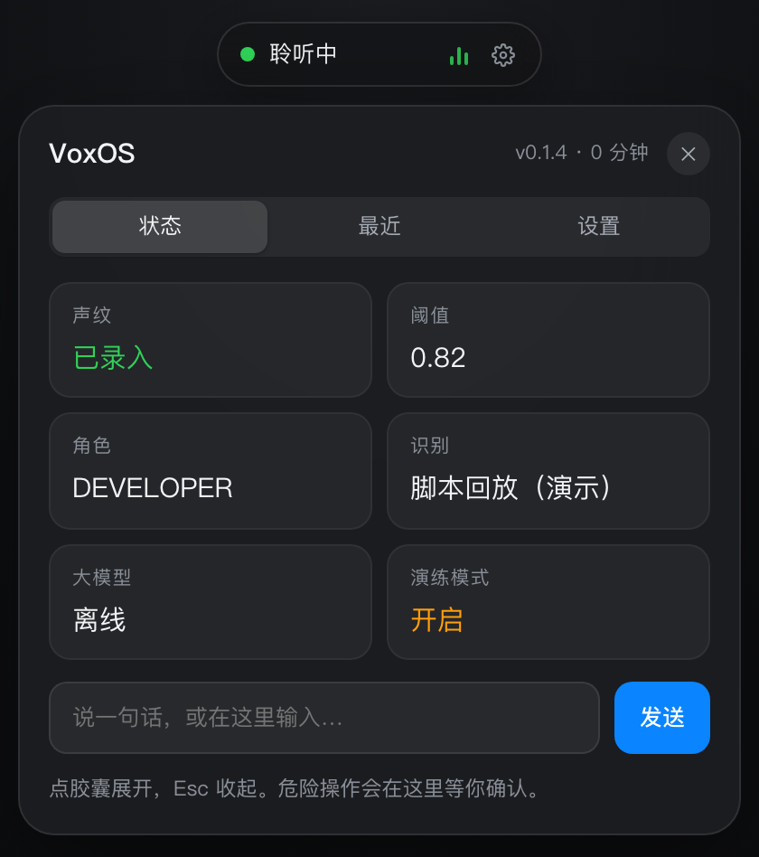
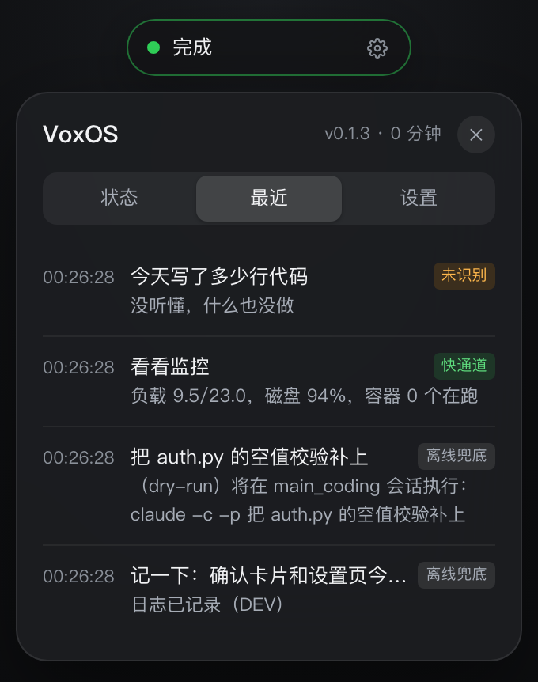
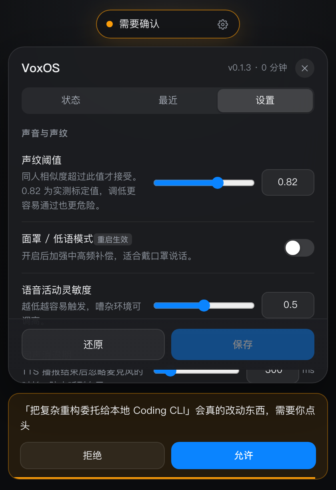
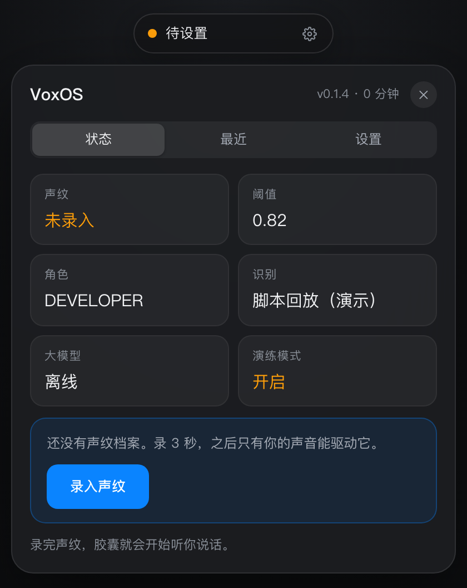
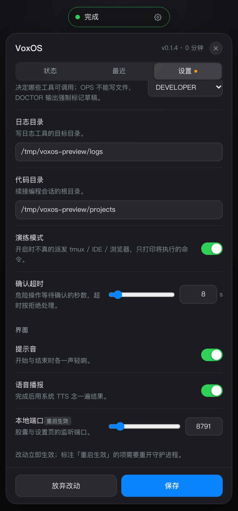
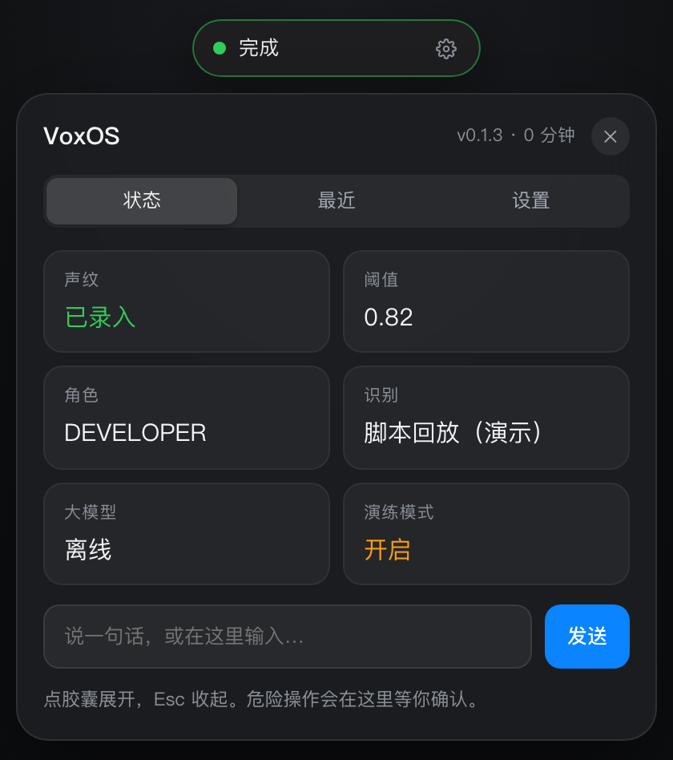
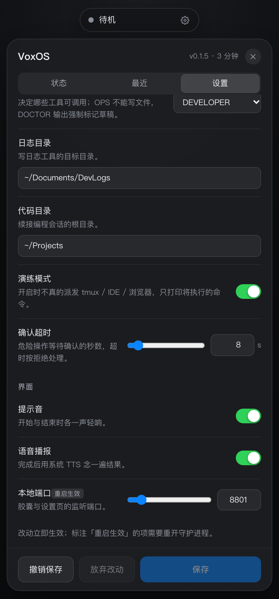

# VoxOS

> **只听你一个人说话的语音操作系统 Agent。**
> 说一句话，它知道你要写日志、写代码还是查运维，然后真的去做，做完用一句话回报你。

没有主窗口，没有聊天记录页。它的形态是一个后台守护进程 + 一个 36px 悬浮胶囊。
声纹不对的语音直接丢弃；危险操作默认没有入口，改动类操作必须二次确认。

```
你说：Siri，我要写日志，今天把登录接口的空值校验补上了
它做：→ 声纹比对 0.95（本人）→ 正则命中（0.8µs）→ 写入今日 Markdown → 胶囊闪绿
它说：日志已记录
```

## 安装（不用源码）

**语言与产物**：Python 3.11+，打出来是 `py3-none-any` 的纯 Python wheel——
不含编译产物，macOS / Linux 通用。核心链路（路由、安全、配置、工具）零第三方依赖，
只有音频部分要 `numpy` + `sherpa-onnx`。

```bash
# 一条命令：取最新 Release → pipx 安装 → 音频依赖 → 自检
curl -fsSL https://raw.githubusercontent.com/jjhuang01/voxos/main/scripts/install.sh | bash
```

不想用管道执行远端脚本，就自己下包再交给同一个脚本（两件事完全等价）：

```bash
gh release download --repo jjhuang01/voxos --pattern '*.whl'   # 仓库公开，不需要登录
bash install.sh ./voxos-0.1.14-py3-none-any.whl                # 或 curl 下 scripts/install.sh
```

脚本里做的事，想手动做也可以：

```bash
pipx install ./voxos-0.1.14-py3-none-any.whl   # 独立 venv，不污染你的环境
pipx inject voxos sherpa-onnx sounddevice      # 音频依赖；跳过则降级为能量 VAD + 脚本回放
voxos models --no-asr                          # 28MB 声纹 + VAD；去掉 --no-asr 是 267MB
voxos doctor
```

> **升级就重跑同一条命令。** 别用 `pipx install --force`：pipx 1.15 走 uv 后端时
> 重建 venv 会报 `A virtual environment already exists at: .`，然后拒绝删除
> "不是本次会话创建的" venv，升级就断在那里。脚本改成先 `pipx uninstall` 再
> `pipx install`——卸载只删 venv，`~/.voxos` 里的模型、声纹、日志一个都不动。

装完就有的命令：

```bash
voxos --version           # 打印版本（和安装包一致，不是手写的另一个数）
voxos models              # 下载/校验模型（先写 .part，校验通过才原子替换）
voxos doctor              # 环境自检（含「配置文件在哪、能不能写」）
voxos enroll --record 3   # 录声纹
voxos run                 # 守护进程 + 胶囊
voxos text "Siri，检查一下服务器负载"   # 不打字说话，直接打字
```

**数据落在哪**：模型、声纹、日志、快照、状态都在 `~/.voxos/`
（`VOXOS_HOME` 换的是**家目录**，默认 `$HOME`，设成 `/data/u` 就落到 `/data/u/.voxos/`），
不在安装目录里——`pipx upgrade` 重建 venv 时不会把你 267MB 的模型一起删掉。
只读资源（红线策略、胶囊页面）跟着安装走。

**配置也归你**：首次启动会把出厂配置复制成 `~/.voxos/settings.toml`，之后设置页和
`--config` 改的都是这一份。装在 venv 里那份只读、而且升级时会被整份替换——
把 268MB 模型配好的 `stt.backend` 写在里面，升级一次就白配了。

> 从源码跑（下面那节）时数据仍在仓库的 `.voxos/`，两种布局互不干扰。

## 30 秒上手

```bash
cd voxos
make setup                                   # 建 .venv 并装依赖（只需一次）
make doctor                                  # 环境自检
python scripts/fetch_models.py               # 三个模型一次下齐（约 267MB）
python scripts/fetch_models.py --no-asr      # 只要声纹 + VAD（28MB，先跑起来再说）
make demo                                    # 无需麦克风/网络/API Key 的端到端演示
make test                                    # 229 项测试
make verify                                  # 工程验收（18 通过 + 1 项未达标）
make verify-release                          # 发布门禁（未达标项走显式豁免，见 Makefile）
make audit-ui                                # 界面回归 12 条（需先 voxos serve）
make install-smoke                           # 装一遍再验（源码跑永远看不到的那 6 项）
```

> `make` 会自动优先使用 `.venv/bin/python`；已有自己的环境就 `PY=/path/to/python make test`。

真机使用：

```bash
PYTHONPATH=src python -m voxos.main enroll --record 3   # 录 3 秒声纹（可跑两次，normal/mask）
PYTHONPATH=src python -m voxos.main run                 # 守护进程 + 胶囊 http://127.0.0.1:8765
PYTHONPATH=src python -m voxos.main pill                # 用无边框小窗打开胶囊（最接近悬浮）
PYTHONPATH=src python -m voxos.main text "Siri，检查一下服务器负载"   # 不想说话？打字也行
```

想让它开机就活着：

```bash
sh scripts/install_launchd.sh --print      # 先看一眼会装什么（plist 全文）
sh scripts/install_launchd.sh              # 装进 ~/Library/LaunchAgents 并立刻拉起
sh scripts/install_launchd.sh --status     # 在跑吗
```

> **先手动跑一次 `voxos run` 再说。** macOS 的麦克风授权框弹不出来给 launchd 守护进程——
> 它只在你亲自启动的那个进程里弹。先手动授权，再交给 launchd。

## 它是什么 / 不是什么

| 是 | 不是 |
| :--- | :--- |
| 一个**只听主人**的本地语音 Agent（声纹锁 + VAD 门控） | 通用语音助手 / 聊天机器人 |
| 三个高频动作做到 100 分：写日志、续接编程会话、只读巡检 | 什么都能干的万能助手 |
| 无头守护进程 + 极简胶囊（状态即界面） | 带主窗口、侧边栏、会话列表的应用 |
| 快通道确定性执行（< 1µs 决策），慢通道 LLM 兜底 | 每句话都先问一遍大模型 |
| 修改类操作强制快照，一句话可回滚 | 让语音直接改你的代码且不可撤销 |

## 架构：四层漏斗 + 双通道路由

```
麦克风 PCM 16k ──► [自愈重连] ──► [回声门] ──► [AGC/面罩EQ]
                                                   │
                                    ┌──────────────▼──────────────┐
                                    │  VAD（Silero / 能量降级）    │ 无语音 → 丢弃，CPU ≈ 0
                                    └──────────────┬──────────────┘
                                                   │ 人声片段
                                    ┌──────────────▼──────────────┐
                                    │ 端点判定（语义尾词等待 2.5s）│ 半截话不会被切断
                                    └──────────────┬──────────────┘
                                                   │ 完整一句话
                                    ┌──────────────▼──────────────┐
                                    │ 声纹锁（CAM++ 192 维余弦）   │ 非本人 → 丢弃，不进 STT/LLM
                                    └──────────────┬──────────────┘
                                                   │ 文本
                          ┌────────────────────────▼────────────────────────┐
                          │ 快通道正则（4 条，<1µs）──命中──► 工具           │
                          │        └─未命中─► LLM 慢通道 ──► tool_calls      │
                          │                    └─不可用─► 离线启发式          │
                          └────────────────────────┬────────────────────────┘
                                                   │ (tool, args)
                                    ┌──────────────▼──────────────┐
                                    │ 安全网关：红线→确认→快照→单飞 │
                                    └──────────────┬──────────────┘
                                                   │
                                        工具执行 + 审计 JSONL
                                                   │
                                     状态总线 ──► SSE ──► 胶囊 + Earcon
```

## 界面：一个胶囊，展开就是全部

点胶囊，在它正下方展开一张 400px 的控制面板 —— **不是主窗口，收起后不留痕迹**。

| 页 | 内容 |
| :--- | :--- |
| **状态** | 声纹是否录入 / 阈值 / 角色 / 识别后端 / 大模型 / 演练开关 + 一句话输入框 |
| **最近** | 最近 8 条：时间、它听成的原文、执行结果、路由 |
| **设置** | 22 个真会改的字段，分组呈现；保存即时生效，保留 TOML 注释；可撤销上一次保存 |

改设置不用重启、不用手改文件；被环境变量接管的字段会置灰并说明是哪一条。
每次保存前会把旧文件留一份在 `.voxos/settings.bak`，所以「撤销保存」能退回保存前的样子——
只退一步，退完备份就消费掉了，界面上的按钮也跟着消失。

界面上的真实状态（`docs/screenshots/`，由 `scripts/shot.py` 驱动真实页面截取）：

| 待机 → 聆听 | 最近（窄到 340px 也不裁标签） |
| :--- | :--- |
|  |  |

| 危险操作等确认（8 秒倒计时） | 首次启动：录 3 秒声纹 |
| :--- | :--- |
|  |  |

| 设置（保存条钉底、页签带未保存点） | 展开时的 hover 反馈 |
| :--- | :--- |
|  |  |

| 有一步可退时：撤销保存 / 放弃改动 / 保存 |
| :--- |
|  |

### 安全边界画在门口

服务只监听 `127.0.0.1`，并且**只有页面本身免令牌**：其余接口都要本次运行的随机令牌，
非本机同源的 `Origin` 一律 403。跨站页面读不到令牌（同源策略），所以
`fetch('http://127.0.0.1:8765/command', ...)` 这类请求到不了执行层。

> 这条是审查时补的：修复前，任意网页都能直接命令它干活。详见 `docs/REVIEW.md`。

## 目录

```text
voxos/
├── AGENTS.md               # AI 编码宪章（改代码前必读）
├── CODING_PHILOSOPHY.md    # 代码审美：深模块 / 无类泛滥 / 40 行 / 物理世界四原则
├── PRD.md                  # 产品需求、用户旅程、消融决策、验收口径
├── REDLINES.md             # 三级风险矩阵与医疗/运维红线
├── PROMPTS_AND_ROUTING.md  # 快慢双通道、热词、Prompt、Session 寻址
├── DESIGN_SYSTEM.md        # 胶囊四态、Earcon、声学补偿、无障碍
├── TODO_ROADMAP.md         # 分阶段验收清单（含真实完成状态）
├── docs/ACCEPTANCE.md      # 实测验收报告（数字来自 scripts/verify.py）
├── config/
│   ├── settings.toml       # 全局配置（TOML，标准库解析）
│   ├── redlines.toml       # 红线正则 + 工具风险等级 + 角色白名单
│   └── ubm.npz             # 降级声纹的背景模型（几 KB）
├── src/voxos/
│   ├── registry.py         # 工具契约：@tool 自省生成 Schema + 快通道 + 注册表
│   ├── safety.py           # 安全边界：红线网关 / 快照回滚 / 单飞执行器 / 审计
│   ├── core.py             # 路由：快慢双通道 + LLM 客户端（re-export 旧入口）
│   ├── tools.py            # 10 个原子工具，每个 ≤ 15 行
│   ├── dsp.py              # 纯函数：AGC / 高架滤波 / VAD / 端点 / 回声门 / 声纹
│   ├── audio.py            # 设备源、自愈重连、Silero/Sherpa 适配、STT、管道
│   ├── ui.py               # 状态总线 + SSE 服务 + Earcon 合成
│   ├── corpus.py           # 验收语料生成（say 合成 / 合成音降级）
│   ├── config.py           # TOML 加载 + 环境变量覆盖
│   ├── settings.py         # 设置层：字段模式 / 校验 / 保留注释的写回 / 撤销
│   ├── main.py             # CLI：text / demo / run / enroll / serve / tools / doctor
│   └── __init__.py
├── web/pill.html           # 36px 胶囊 + 展开式控制面板（状态/最近/设置）
├── scripts/
│   ├── verify.py           # 工程验收：延迟/FRR/FAR/红线矩阵/混说召回/代码度量 → HTML 报告
│   ├── audit_ui.py         # 界面回归：把审查里「量出来的数」变成 12 条断言
│   ├── soak.py             # 长稳：实时节奏喂音频，采样 phys_footprint/CPU（RSS 会骗人）
│   ├── fetch_models.py     # 模型下载（支持代理；--no-asr 跳过 239MB 识别模型）
│   ├── shot.py             # 零依赖 CDP 客户端：截 10 个界面状态，也能当探针量尺寸
│   ├── install_launchd.sh  # 装成开机自启的 launchd 守护（含 TCC 授权提醒）
│   ├── build_ubm.py        # 生成降级声纹背景模型
│   └── enroll_voice.py     # 声纹录入（显式版）
└── tests/                  # 226 项：内核/安全/工具/DSP/管道/UI/设置/路由/打断/STT/端到端/文档自洽
```

## 四条关键设计决策

**1. 快通道永远先跑。** "我要写日志"是确定意图，让 LLM 去推理它等于花 800ms 和一份 API 费
去重新发现一个正则能确定的事实。实测快通道决策 p95 = **0.0008ms**。

**2. 函数即插件。** 加一个能力 = 在 `tools.py` 写一个带 `@tool` 的普通函数。
JSON Schema 由类型注解自省生成（`registry.py`），正则快通道由装饰器参数声明，Prompt 自动带上。
**改一个参数不需要同步改第二处。**

**3. 复用 OS 原语，不自研状态机。** 编程会话归 `tmux` 与 `claude -c` 所有；
我们只做寻址（`has-session` / `send-keys`）。没有 `sessions.json`，没有状态同步。

**4. UI 只是订阅者。** 核心进程无头，状态通过本地 SSE 广播，胶囊是一个独立 HTML。
杀掉胶囊，Agent 照常工作；换成终端输出，也只改一行。

## 四个物理世界陷阱（这是和"玩具 Demo"的分界线）

| 陷阱 | 现象 | 落地 |
| :--- | :--- | :--- |
| **声学自激死循环** | Agent 听到自己的 TTS → 无限触发 | `dsp.EchoGate`：播报期 + 300ms 混响期丢弃音频，仅放行"停/算了"等打断词 |
| **蓝牙/面罩热插拔** | PortAudio `-9988` 直接崩进程 | `audio.SelfHealingSource`：`while True + backoff 2s`，设备重枚举后自动恢复 |
| **半截话误触发** | "我要写代码…（想 1.2s）…加个校验" 只执行前半句 | `dsp.EndpointDetector`：以未完虚词结尾时静音窗 0.8s→2.5s |
| **并发重入写坏文件** | 两句"改 auth.py"并发写同一文件 | `core.Executor` 单飞锁：修改类工具串行，绿色工具不受限 |

## 降级矩阵（没有模型/没有依赖时会发生什么）

| 组件 | 首选 | 降级 | 影响 |
| :--- | :--- | :--- | :--- |
| VAD | Silero ONNX（实时率 0.4%） | 能量 VAD（自适应底噪） | 嘈杂环境误触发率上升 |
| 声纹 | CAM++ 192 维 | 频谱统计 + UBM | **FRR/FAR 不再满足 PRD**，仅保证链路可跑 |
| STT | **SenseVoice int8（本地，239MB，20–38× 实时，视机器负载）** | faster-whisper / OpenAI 兼容接口 / 脚本化 | 本地识别不出网；脚本化仅用于测试与演示 |
| LLM | 任意 OpenAI 兼容（Ollama/DeepSeek/Claude） | 离线启发式（4 条规则） | 只认三大高频场景，其余不执行 |
| GUI | 无头 + SSE 胶囊 | CLI 状态行 | 无 |

## 与原始规划文档的差异（以及为什么）

| 文档写的 | 实际做的 | 原因 |
| :--- | :--- | :--- |
| `config/settings.yaml` | `settings.toml` | 标准库 `tomllib` 解析，零依赖；字段一一对应 |
| 4 个源文件（core/tools/audio/main） | 7 个模块（多 dsp/ui/config/corpus） | 音频纯计算与设备 I/O 混在一个文件会同时违反"40 行"和"可单测"；`dsp.py` 无 I/O 所以能离线测 |
| PyQt6 悬浮胶囊 | 本地 SSE + 50 行 HTML | 避免 GUI 主线程与音频线程争 GIL，且胶囊可随时替换 |
| 声纹阈值 0.76 | **0.82** | 实测同人最小 0.849 / 异人最大 0.782，取中点；0.76 时同性别冒充 FAR 1.67%（见验收报告） |
| 手写 TOOLS_SCHEMA 字典 | 类型注解自省生成 | 两处维护必然不一致 |
| `sessions.json` 会话管理 | tmux 原生会话 | 不重复造状态机 |

## 隐私与安全

- 原始音频**不落盘**，只在内存环形缓冲中存活到句子结束。
- 声纹是**单向嵌入**（不可逆），存 `.voxos/voiceprint_profiles.npz`，不入 Git。
- 所有工具调用强制经过 `core.Executor.execute_safely()`，`REDLINES.md` 中的禁令
  没有工具入口，不是"有入口但拦一下"。
- 审计日志 `.voxos/audit.jsonl` 记录：时间、转写、工具、参数摘要、风险等级、耗时、结果。

## 依赖

```bash
pip install -e ".[models]"     # numpy + sherpa-onnx + onnxruntime（推荐）
pip install -e ".[audio]"      # + sounddevice（真麦克风）
pip install -e ".[dev]"        # + pytest
python scripts/fetch_models.py # 声纹 + VAD + SenseVoice 识别模型（约 267MB）
```

核心链路（core/tools/ui/config）**只用标准库**；numpy 仅用于音频。

模型三件套与用途：

| 文件 | 大小 | 缺了会怎样 |
| :--- | :--- | :--- |
| `.voxos/models/campplus.onnx` | 27MB | 声纹退化成频谱统计，FRR/FAR 不再满足 PRD |
| `.voxos/models/silero_vad.onnx` | 0.6MB | 退化成能量 VAD，嘈杂环境误触发变多 |
| `.voxos/models/sense-voice/model.int8.onnx` + `tokens.txt` | 239MB | `stt.backend=sense_voice` 起不来；改成 `scripted` 仍可跑通链路 |

识别率不是估的：24 句 TTS 语料 818 字，字符错误率 **2.8%**（中文 1.4%、英文 3.1%）。
中文那 1.4% 全是「十点→10点」这类数字规范化。

速度别记成单个数：单次解码实测 3 秒音频 94ms（**32×**）、4.9 秒 138ms（**36×**）；
机器上有别的进程抢 CPU 时会掉到 **20×** 上下。`make verify` 报的是当次的最差值。

**但这不是中英混说的成绩。** 上面那组是英文句子用英文音色读，量的是英文识别。
真实场景是中文句子里夹术语——「把 redis 的连接池调大一点」。两版语料一起量：

| 语料 | 术语召回 | 典型错法 |
| :--- | ---: | :--- |
| 中文音色念术语 | 29.4% | `docker`→`care`、`nginx`→`in` |
| 双语拼接（术语用英文音色） | **47.1%** | `nginx`→`gaangs`、`docker`→`doggcker` |

中文本身没问题（字错 9.6%）。双语拼接更接近真人的念法，能救回 `sql`/`python`/`token`，
但 `nginx`/`docker`/`git rebase` 照样错——所以这**不只是发音问题**：模型对中文语境里的
英文术语本来就弱。热词偏置在 sherpa-onnx 的 SenseVoice 上没有接口，想达标得换支持
contextual biasing 的双语模型。详见 `docs/REVIEW.md §22` 与 `§27`。

识别后端在设置页切换（`stt.backend`），默认 `scripted`（不依赖模型，CI 与演示用）。
换成 `sense_voice` 后完全离线，音频不出本机。
